
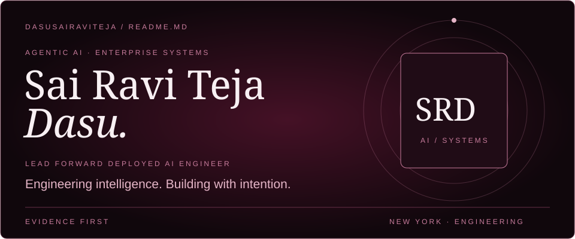

<a href="https://github.com/dasusairaviteja/SAI-Portfolio"><b>PORTFOLIO SOURCE ↗</b></a> &nbsp; · &nbsp; <a href="https://www.linkedin.com/in/sai-teja-ai-engineer"><b>LINKEDIN ↗</b></a> &nbsp; · &nbsp; <a href="mailto:sairaviteja629@gmail.com"><b>EMAIL ↗</b></a>

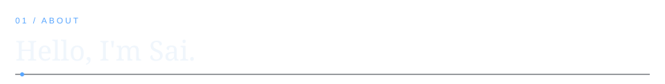

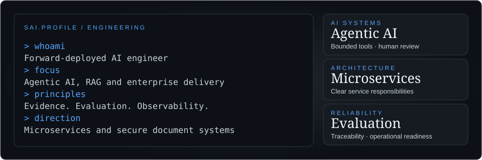

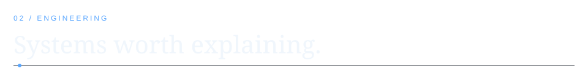

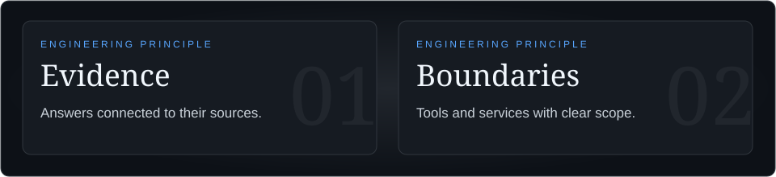

<a href="https://github.com/dasusairaviteja/enterprise_apollo_CRE">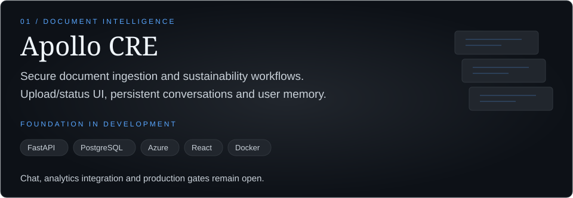</a>

<a href="https://github.com/dasusairaviteja/enterprise_apollo_CRE"><b>EXPLORE REPOSITORY ↗</b></a>

<a href="https://github.com/dasusairaviteja/clinical-trial-eligibility-investigator">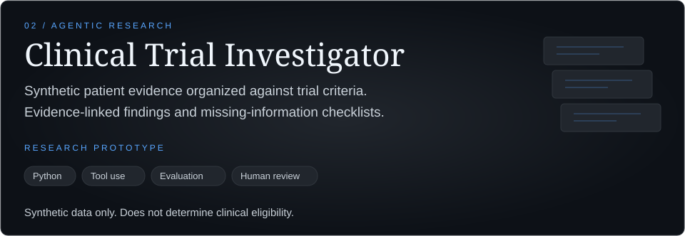</a>

<a href="https://github.com/dasusairaviteja/clinical-trial-eligibility-investigator"><b>EXPLORE REPOSITORY ↗</b></a>

<a href="https://github.com/dasusairaviteja/ML_Pipeline_Prices_Predictor_System">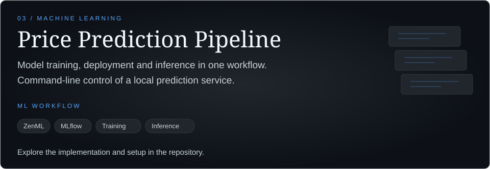</a>

<a href="https://github.com/dasusairaviteja/ML_Pipeline_Prices_Predictor_System"><b>EXPLORE REPOSITORY ↗</b></a>

<a href="https://github.com/dasusairaviteja/SAI-Portfolio">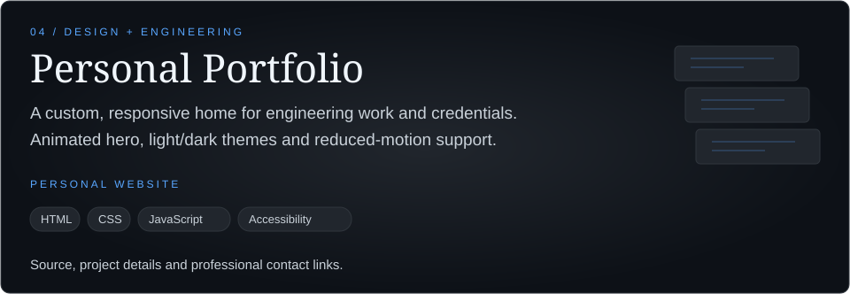</a>

<a href="https://github.com/dasusairaviteja/SAI-Portfolio"><b>EXPLORE REPOSITORY ↗</b></a>

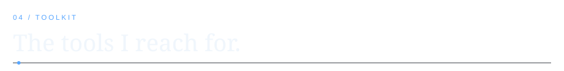

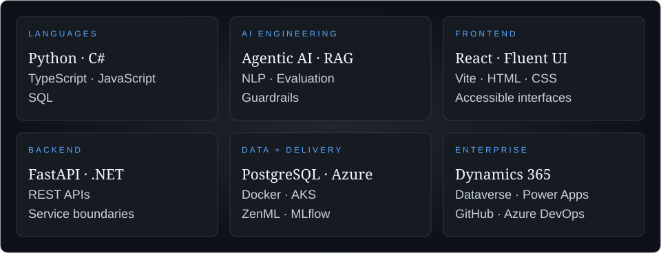

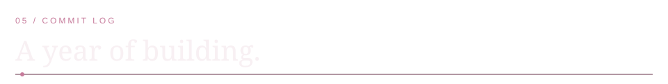

<!-- ACTIVITY:START -->
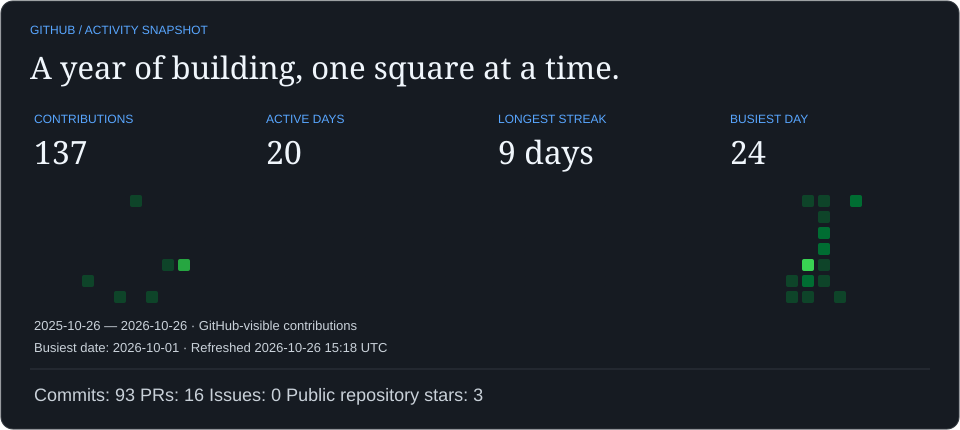

Activity figures and refresh details

| Contributions | Active days | Longest streak | Busiest day |
| :--- | :--- | :--- | :--- |
| 137 | 20 | 9 days | 2026-10-01 (24 contributions) |

| Commit contributions | Pull-request contributions | Issue contributions | Stars on owned public non-fork repositories |
| :--- | :--- | :--- | :--- |
| 93 | 16 | 0 | 3 |

Calendar period: 2025-10-19 to 2026-10-19. GitHub-visible contribution data; stars are a current total, not a yearly count. Updated 2026-10-19 15:44 UTC. Scheduled daily; last successful update remains visible if a refresh fails.

<!-- ACTIVITY:END -->

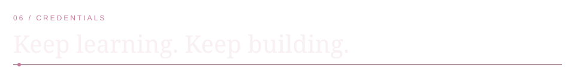

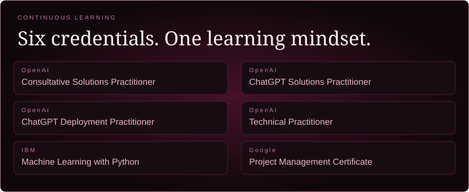

<b>View credential records ↗</b>

| Credential | Issuer | Record |
| :--- | :--- | :--- |
| OpenAI Consultative Solutions Practitioner | OpenAI | [Credential](https://oaipartnernetwork.credential.net/957d7ccb-51cc-4222-9739-61fe85ef7738) |
| ChatGPT Solutions Practitioner | OpenAI | [Credential](https://oaipartnernetwork.credential.net/86a931e3-95f3-4279-8c1d-c5d4a24f4dde) |
| ChatGPT Deployment Practitioner | OpenAI | [Credential](https://oaipartnernetwork.credential.net/b9326505-edb1-4773-93e6-3075eb447500) |
| OpenAI Technical Practitioner | OpenAI | [Credential](https://oaipartnernetwork.credential.net/9ae21cd4-d081-430b-9aef-577046f28685) |
| Machine Learning with Python | IBM | [Credential](https://www.coursera.org/account/accomplishments/verify/6C9U1B3ZAD9L) |
| Google Project Management Professional Certificate | Google | [Credential](https://www.coursera.org/account/accomplishments/specialization/PP5C1WYEPUD9) |

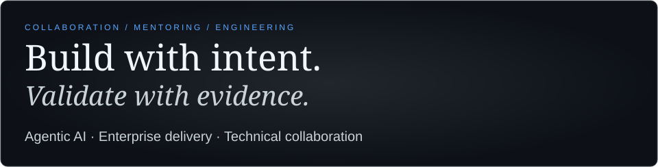

<a href="mailto:sairaviteja629@gmail.com">EMAIL</a> &nbsp; · &nbsp; <a href="https://www.linkedin.com/in/sai-teja-ai-engineer">LINKEDIN</a> &nbsp; · &nbsp; <a href="https://github.com/dasusairaviteja/SAI-Portfolio">PORTFOLIO SOURCE</a>

