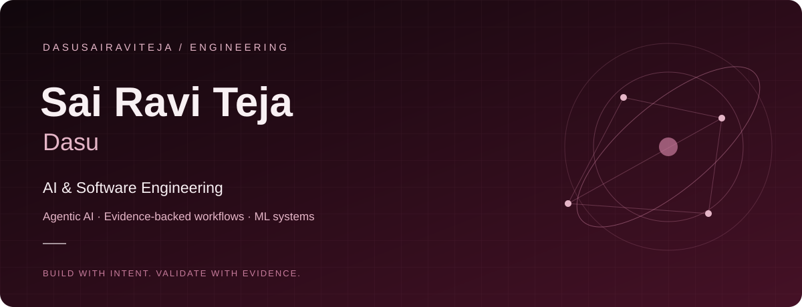

<h1 align="center">Sai Ravi Teja Dasu</h1>

<strong>Lead Forward Deployed AI Engineer · Agentic AI · Enterprise Software</strong> Engineering intelligence. Building systems that can explain themselves.

<a href="https://github.com/dasusairaviteja/SAI-Portfolio">Portfolio source</a> · <a href="https://www.linkedin.com/in/sai-teja-ai-engineer">LinkedIn</a> · <a href="mailto:sairaviteja629@gmail.com">Email</a>

---

## 01 / About
### Hello, I'm Sai.

I focus on turning complex business problems into reliable AI systems. My portfolio centers on forward-deployed AI engineering, agentic workflows, retrieval-augmented generation, and enterprise delivery.

I care about the complete engineering process: understanding the problem, designing the system, implementing it, and evaluating its behavior. My priorities are evidence, explicit uncertainty, observability, and human review where decisions matter.

**Current direction:** production agentic AI, microservices architecture, evaluation, and secure document intelligence.

## 02 / Engineering focus
### Make the reasoning inspectable.

| Focus | What matters to me |
| :--- | :--- |
| Agentic AI | Bounded tool use, clear responsibilities, and human review |
| Retrieval & grounding | Traceable sources and evidence-linked answers |
| Microservices | Clear service boundaries and independently deployable components |
| Reliability | Evaluation, guardrails, observability, and operational readiness |

## 03 / Selected work
### From problem to implementation.

#### Apollo Real Estate Sustainability Intelligence
A foundation for secure document ingestion and evidence-backed sustainability workflows. Includes a React document-upload interface and persistent conversation and user-memory endpoints.

**Python · FastAPI · PostgreSQL · Azure · React · TypeScript · Docker**

Foundation in development; AI chat and analytics integration and production gates remain open. Microservices are a design direction, not a claim of a completed migration.

[Repository →](https://github.com/dasusairaviteja/enterprise_apollo_CRE)

#### Clinical Trial Eligibility Investigator
Research screening support that organizes synthetic patient evidence against trial criteria, records uncertainty, and produces findings for human review.

**Python · Tool-using agents · Evidence-linked reports · Evaluation**

Research prototype using synthetic data; it does not decide clinical eligibility.

[Repository →](https://github.com/dasusairaviteja/clinical-trial-eligibility-investigator)

#### ML Pipeline for Price Prediction
A workflow for model training, deployment, and inference with command-line control of a local prediction service.

**ZenML · MLflow**

[Repository →](https://github.com/dasusairaviteja/ML_Pipeline_Prices_Predictor_System)

#### Personal Portfolio
An accessible, responsive portfolio with a custom animated hero, light/dark themes, reduced-motion support, and sections for engineering work and credentials.

**HTML · CSS · JavaScript**

[Source & project details →](https://github.com/dasusairaviteja/SAI-Portfolio)

## 04 / Toolkit
### The tools I reach for.

| Area | Technologies & practices |
| :--- | :--- |
| Languages | Python, C#, JavaScript, TypeScript, SQL |
| AI engineering | Agentic workflows, RAG, NLP, evaluation, guardrails |
| Frontend | React, Fluent UI, Vite, HTML, CSS |
| Backend | FastAPI, .NET, REST APIs |
| Data & cloud | PostgreSQL, SQL Server, Azure, Microsoft Entra ID |
| Delivery & ML workflows | Docker, AKS, GitHub Actions, Azure DevOps, ZenML, MLflow |
| Enterprise platforms | Dynamics 365, Dataverse, Power Apps, Power Automate |

## 05 / Commit log
### A year of building.

<!-- ACTIVITY:START -->

| Contributions | Active days | Longest streak | Busiest day |
| :--- | :--- | :--- | :--- |
| 132 | 20 | 9 days | 2026-10-01 (24 contributions) |

| Commit contributions | Pull-request contributions | Issue contributions | Stars on owned public non-fork repositories |
| :--- | :--- | :--- | :--- |
| 88 | 16 | 0 | 3 |

Calendar period: 2025-10-19 to 2026-10-18. GitHub-visible contribution data; stars are a current total, not a yearly count. Updated 2026-10-18 15:37 UTC. Scheduled daily; last successful update remains visible if a refresh fails.

<!-- ACTIVITY:END -->

[Refresh workflow & run history](https://github.com/dasusairaviteja/dasusairaviteja/actions/workflows/contributions.yml)

## 06 / Certifications
### Keep learning. Keep building.

Credentials listed in my portfolio, with links to the credential records.

| Credential | Issuer | Record |
| :--- | :--- | :--- |
| OpenAI Consultative Solutions Practitioner | OpenAI | [Credential](https://oaipartnernetwork.credential.net/957d7ccb-51cc-4222-9739-61fe85ef7738) |
| ChatGPT Solutions Practitioner | OpenAI | [Credential](https://oaipartnernetwork.credential.net/86a931e3-95f3-4279-8c1d-c5d4a24f4dde) |
| ChatGPT Deployment Practitioner | OpenAI | [Credential](https://oaipartnernetwork.credential.net/b9326505-edb1-4773-93e6-3075eb447500) |
| OpenAI Technical Practitioner | OpenAI | [Credential](https://oaipartnernetwork.credential.net/9ae21cd4-d081-430b-9aef-577046f28685) |
| Machine Learning with Python | IBM | [Credential](https://www.coursera.org/account/accomplishments/verify/6C9U1B3ZAD9L) |
| Google Project Management Professional Certificate | Google | [Credential](https://www.coursera.org/account/accomplishments/specialization/PP5C1WYEPUD9) |

## 07 / Connect
### Let's build something worth explaining.

Interested in AI engineering, enterprise delivery, mentoring, or technical collaboration? Let's connect.

[Email](mailto:sairaviteja629@gmail.com) · [LinkedIn](https://www.linkedin.com/in/sai-teja-ai-engineer) · [Portfolio source](https://github.com/dasusairaviteja/SAI-Portfolio) · [GitHub](https://github.com/dasusairaviteja)

